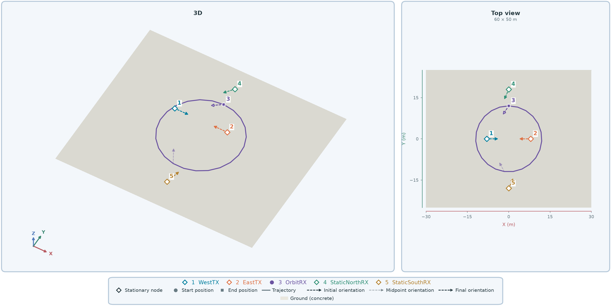

# Multiple-Device Beamforming

[Scenarios](../../../README.md) > [Visualizer](../../README.md) >
[Beamforming](../README.md) > Multiple Devices

This scenario contains two transmitters and three receivers. It demonstrates
explicit TX/RX pair selection, beam-overlay updates, and steering behavior
when the selected devices have different positions and orientations.

To run it, see [Running](#running).

## Scene Layout



- `WestTX` and `EastTX` are fixed at `(-8.0 m, 0.0 m, 8.0 m)` and
  `(8.0 m, 0.0 m, 8.0 m)`.
- `OrbitRX` follows a 12.0 m-radius clockwise circle at `1.5 m` height.
  `StaticNorthRX` and `StaticSouthRX` remain at `y = 18.0 m` and
  `y = -18.0 m`.
- The scenario uses ORCHAV's 28 GHz carrier and half-wavelength spacing
  defaults, with explicit 4x8 `tr38901` transmitter and `dipole` receiver
  arrays.

## Configuration Walkthrough

The [scenario.yaml](scenario.yaml) sets the transmitter array under
`raytracing.antenna`:

```yaml
raytracing:
  antenna:
    tx:
      pattern: tr38901
      num_rows: 4
      num_cols: 8
```

The receiver also uses a 4 × 8 array, with dipole elements. These settings
initialize the **Antennas** controls. Later panel edits affect only the display.
See [antenna configuration](../../../../docs/generator/configuration.md#antenna-arrays)
for the available settings.

## Running

From the repository root, generate the frames:

```bash
orchav-generator scenarios/visualizer/beamforming/multi_device
```

Open the scenario in the Visualizer:

```bash
orchav-visualizer --scenario scenarios/visualizer/beamforming/multi_device --no-resume
```

Generation saves reusable HDF5 frames under `frames/` and standalone layout
and speed figures under `summary/`.
The scenario has 24 steps over 6 seconds.

## What To Inspect

1. Under **Scene → Nodes → Labels**, set **TX/RX text** to **Device Name**.
2. In **Context → TX/RX Scope**, select TX **WestTX** and RX **OrbitRX**.
   Leaving either field at **All** disables beam patterns.
3. Open **Antennas → Pattern Source**, select **Standalone**, and enable
   **Show Beam Patterns**.
4. Under **Shared TX/RX Parameters**, choose **LOS Steering** as the
   **Strategy**, then play or scrub the timeline.
5. Change the pair in **Context** to **EastTX** and **StaticSouthRX**. Both
   surfaces move to the new pair. Compare **Manual Steering** and
   **SVD (Current MPCs)** for this selection.

Paths start hidden to keep the surfaces easy to see. **Frame Data** is
unavailable because these frames do not contain saved beamforming weights.
For steering behavior and limitations, see
[Beam-Pattern Visualization](../../../../docs/visualizer/beam_patterns.md).

## Browse Scenarios

Up: [Beamforming](../README.md) ·
[Circular Receiver](../circular_rx/README.md)
