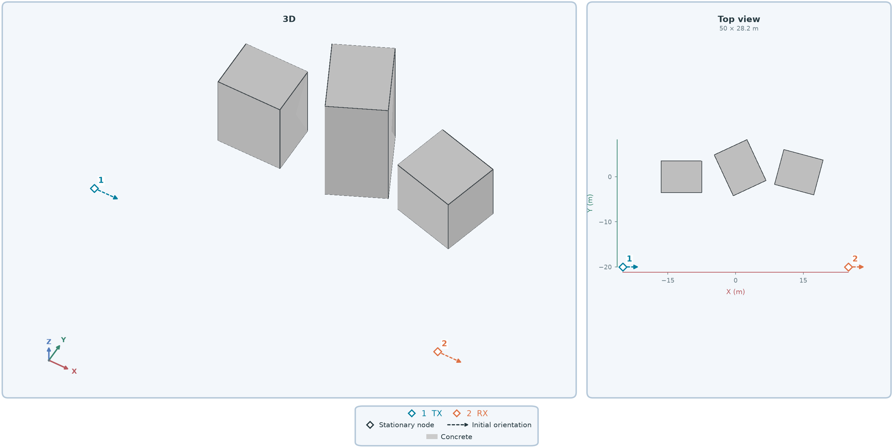
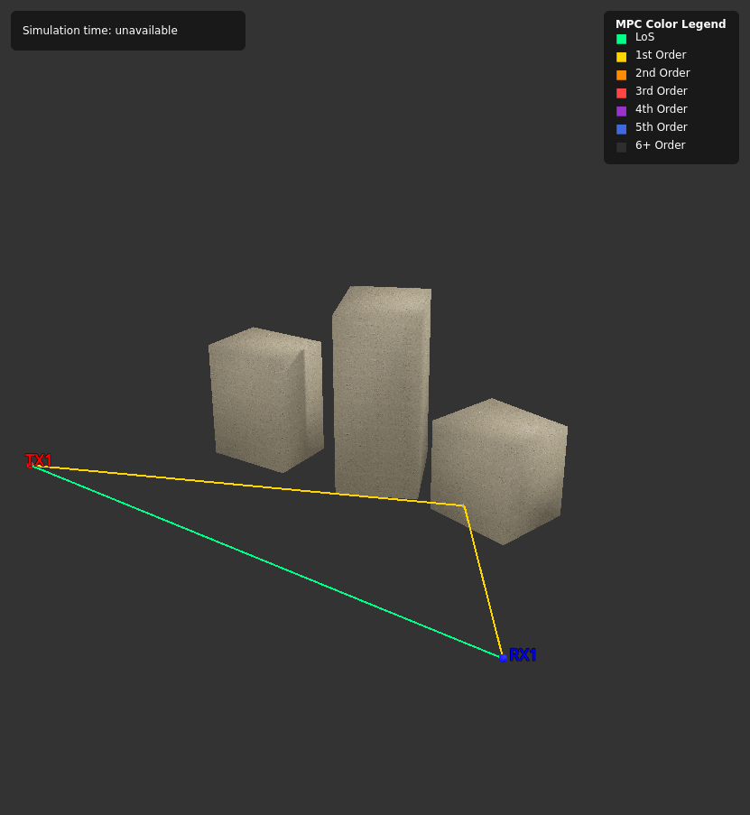
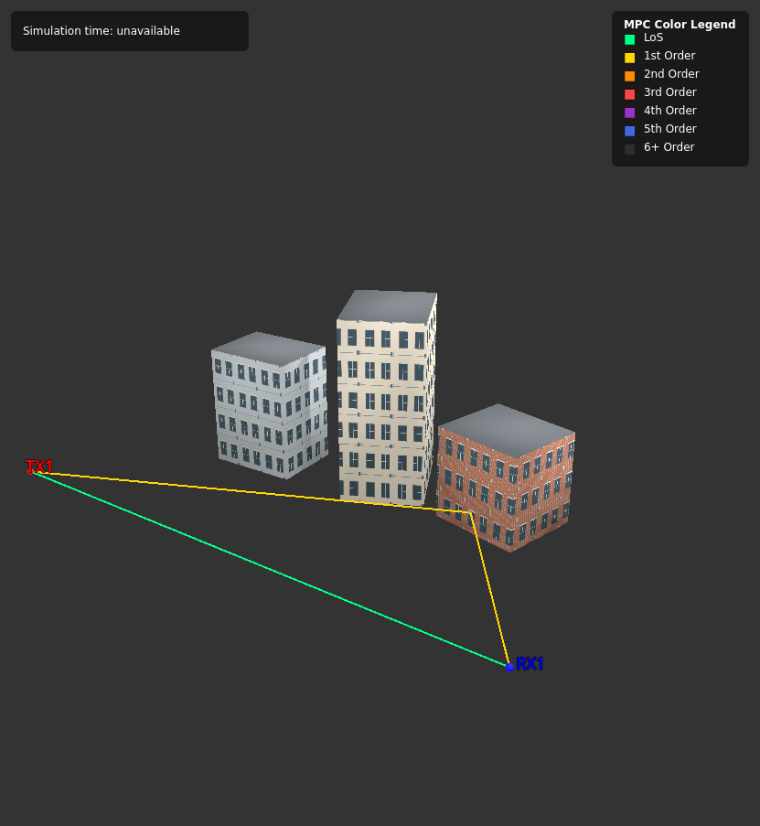

# Building Appearance

[Scenarios](../../README.md) > [Visualizer](../README.md) > Building Appearance

Compare Detailed, Paper, and Glow views on the same saved frame, then try
procedural facades on three simple buildings. This small local scene lets you
explore the Visualizer's appearance controls without downloading a city.
The [Paris Opéra scenario](../../generator/paris_opera_osm/README.md) focuses
on acquiring geographic geometry; this exercise focuses on how to display it.

To run it, see [Running](#running).

## Scene Layout



The three concrete blocks are 12 m, 18 m, and 9 m high. Two are rotated by
25° and −15°. TX is at (−25 m, −20 m, 3 m), and RX is at
(25 m, −20 m, 1.5 m). These are original synthetic meshes with building-face
annotations. One static frame provides the paths to inspect.

| Original materials | Procedural facades |
|---|---|
|  |  |

## Running

From the repository root, generate the frame using the
[included scene inputs](../../generator/building_appearance/README.md):

```bash
orchav-generator scenarios/generator/building_appearance
```

Open it with pygfx:

```bash
orchav-visualizer --no-resume --enable-textures \
  --scenario scenarios/generator/building_appearance
```

If frames already exist, run only the Visualizer command. Generation writes
HDF5 data under the input scenario's `frames/` directory. Appearance changes
reuse that recording without running ray tracing again.

## Compare Scene Looks

Keep the frame and camera fixed. Under **Rendering → Appearance**, try:

| Look | What to compare |
|---|---|
| **Detailed** | Lit surfaces and available facade textures make building shape and scale easier to read. |
| **Paper** | A white background, radio-material colors, and fine mesh edges help inspect geometry. |
| **Glow** | Violet surroundings and bloom offer a presentation view of the same scene and paths. |

The camera, recorded data, and MPC coloring stay unchanged when selecting a
look. Choose path colors separately under **Paths → Color By**. Use
**Previous look** to compare two appearances. See
[Appearance presets](../../../docs/visualizer/appearance.md) to save
and reuse a look.

No preset downloads a sky automatically. Detailed uses the lighting assets
already available; an optional sky can be installed from the lighting panel.

## Compare Procedural Facades

Return to **Detailed**, then open **Rendering → Surfaces → Buildings**:

1. Compare **Original materials** with **Repeated facade textures**. Windows
   repeat at a 3 m floor scale and follow the rotated walls; roofs stay neutral.
2. Choose **Facades by building**, then change **Facade theme**. Compare how
   the illustrated floors and windows fit the 9 m, 12 m, and 18 m blocks.
3. Try **Portuguese tiles** or **Haussmann detail** on the same geometry.
   Themes add illustrative surface detail; they do not identify the buildings'
   real location or construction.

Window artwork adds no openings, interiors, or scattering surfaces. Geometry,
radio materials, and saved paths stay the same. Procedural textures are
created locally and need no texture download.

## Which Scenes Support These Controls?

**Detailed, Paper, and Glow** can be used on ordinary scenes. Procedural
facades additionally need metadata identifying which mesh faces are buildings.
OSM scene generation supplies this information, but OSM is not required: this
example provides it in
[`building_visuals.json`](../../generator/building_appearance/scene/building_visuals.json).
**Facades by building** also needs the boundaries of individual building parts.

A scene without this metadata cannot use procedural facades. The Visualizer
does not infer buildings from filenames. Authored textures and explicit visual
material assignments can take precedence over generated facades. See the
[building appearance reference](../../../docs/visualizer/appearance.md#building-and-road-surfaces)
for the metadata format and precedence rules.

Road markings need their own road metadata, and **Plan** needs a saved street
graph. This three-building scene has neither. Use the
[tagged road and path example](../../generator/building_appearance/surfaces/README.md)
to compare surface patterns, or the Paris Opéra scene for a street network.

[Image provenance](../../../docs/assets/building_appearance/provenance.json)
records the illustrated scene and camera.

## Browse Scenarios

Up: [Visualizer Scenarios](../README.md) | Related:
[Appearance Presets](../../../docs/visualizer/appearance.md) |
[Paris Opéra from OSM](../../generator/paris_opera_osm/README.md)
