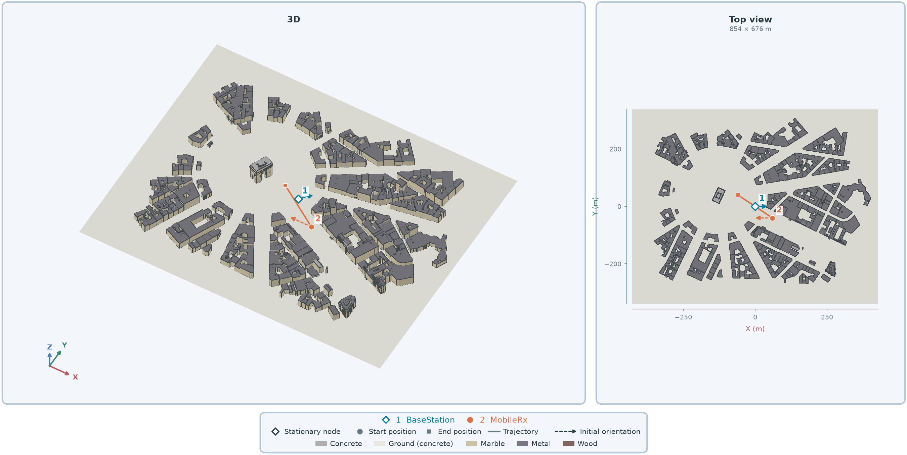

# Local HDF5 Playback

[Scenarios](../../../README.md) > [Visualizer](../../README.md) >
[Data Modes](../README.md) > Local HDF5 Playback

Generate frames once, then open the same local `frames/` directory repeatedly
in the Visualizer, inspect it with ORCHAV tools, or copy it to another checkout
or host when needed.

To run it, see [Running](#running).

## Scene Layout



| Element | Configuration |
| --- | --- |
| `BaseStation` | Fixed transmitter above the Etoile scene |
| `MobileRx` | Receiver moving diagonally across the scene over 50 frames |
| `data.mode` | `files` (the default Local HDF5 Playback mode) |

## Configuration Walkthrough

The [scenario.yaml](scenario.yaml) omits `data` because local file output is
the default. Generation saves reusable
[HDF5 frames](../../../../docs/shared/frame_reference.md#hdf5-frame-layout)
under `frames/`.

## Running

From the repository root, generate the frames:

```bash
orchav-generator scenarios/visualizer/data_modes/hdf5_files
```

Open the scenario in the Visualizer:

```bash
orchav-visualizer --scenario scenarios/visualizer/data_modes/hdf5_files --no-resume
```

## What To Inspect

1. Open **System → Data Source**. It reports mode **File**, the local HDF5
   location, and a total of 50 frames.
2. Scrub from the first frame to the last and watch `MobileRx` move across
   the scene.
3. Close the Visualizer and run its command again. The saved frames reopen
   without running the Generator again.

## Local What-if Preview

With pygfx and local Sionna RT dependencies, this example can use **Local
What-if Preview** for a temporary current-frame actor or solver change. Follow
[Interactive Recomputation](../../../../docs/visualizer/interactive_recomputation.md#local-what-if-preview)
for the controls and persistence boundary.

## Browse Scenarios

Up: [Data Modes](../README.md) ·
[Live Generator](../live_grpc/README.md) ·
[Remote HDF5 Playback](../remote_hdf5/README.md)
