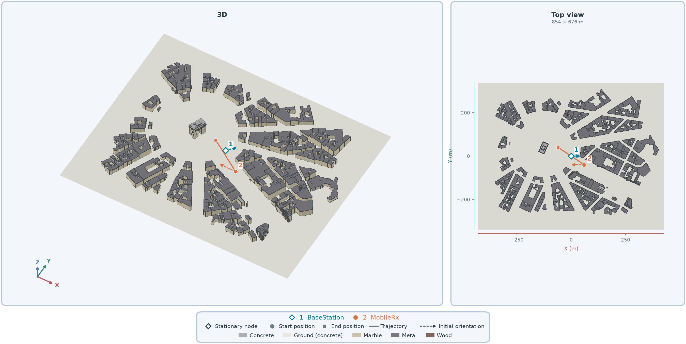

# Live Generator (gRPC)

[Scenarios](../../../README.md) > [Visualizer](../../README.md) >
[Data Modes](../README.md) > Live Generator (gRPC)

Connect the Visualizer to a running Generator, request frames as you explore
the timeline, and try moving the receiver to recompute its propagation paths.

To run it, see [Running](#running).

## Scene Layout



`BaseStation` stays 30 m above the Etoile scene. `MobileRx` follows a linear
street-level route over 50 frames and 5 s.

## Configuration Walkthrough

The [scenario.yaml](scenario.yaml) selects live generation:

```yaml
data:
  mode: live_grpc
```

The Generator and Visualizer use `localhost:50051` by default. Requested
frames are computed and cached in memory; this mode does not save a `frames/`
directory.

## Running

From the repository root, install the gRPC extra:

```bash
python -m pip install -e ".[grpc]"
```

In the first terminal, start the Generator and leave it running:

```bash
orchav-generator scenarios/visualizer/data_modes/live_grpc
```

In a second terminal, connect the Visualizer:

```bash
orchav-visualizer --scenario scenarios/visualizer/data_modes/live_grpc --no-resume
```

## What To Inspect

1. Open **System → Data Source**. It reports **Live gRPC** and the connection
   and frame-buffer status.
2. Scrub to a later frame. The Generator computes the requested frame, and
   `MobileRx` moves to that point on its route.
3. Keep the Generator running while you explore. One Visualizer controls the
   live session at a time.

## Try A Live Edit

1. Pause playback. Under **Edit → Actor Editing**, select **Enable Live Actor
   Editing**.
2. Select `MobileRx` in the scene, move it with the transform gizmo, and release
   the gizmo. The Generator recomputes the paths for the edited pose.
3. To compare solver settings, change the quality preset under
   **Edit → Raytracing**, then choose **Apply Raytracing Changes**.

These edits affect the current session. To make a change permanent, edit
`scenario.yaml` and restart the Generator. See
[Interactive Recomputation](../../../../docs/visualizer/interactive_recomputation.md)
for the supported edits and reset controls.

When finished, close the Visualizer and stop the Generator with **Ctrl+C**.
If the connection is lost, restart the Generator as needed and reopen the
scenario. For another port or host, see the
[connection options](../../../../docs/visualizer/cli_reference.md).

## Browse Scenarios

Up: [Data Modes](../README.md) ·
[Local HDF5 Playback](../hdf5_files/README.md) ·
[Remote HDF5 Playback](../remote_hdf5/README.md)
