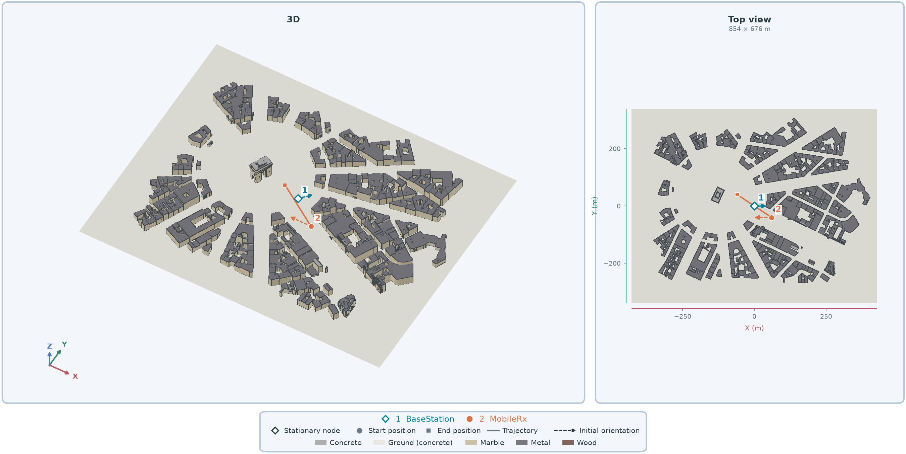

# Remote HDF5 Playback

[Scenarios](../../../README.md) > [Visualizer](../../README.md) >
[Data Modes](../README.md) > Remote HDF5 Playback

Open a saved recording through a frame server while its HDF5 files stay on the
server's machine. This walkthrough starts with both processes on your computer,
then explains how to connect from another machine.

To run it, see [Running](#running).

## Scene Layout



`BaseStation` stays 30 m above the Etoile scene. `MobileRx` follows a linear
street-level route over 50 frames and 5 s.

## Configuration Walkthrough

The Visualizer's [scenario.yaml](scenario.yaml) selects remote playback:

```yaml
data:
  mode: remote_hdf5
```

It connects to `localhost:50052` by default. The separate
[generation setup](generation/README.md) uses
[generation/scenario.yaml](generation/scenario.yaml) to define the same scene
with ordinary file output. Generate that recording first, then serve its saved
frames. The server reads HDF5 data without running ray tracing.

## Running

From the repository root, install the gRPC extra:

```bash
python -m pip install -e ".[grpc]"
```

**1. Generate the recording:**

```bash
orchav-generator scenarios/visualizer/data_modes/remote_hdf5/generation
```

This creates reusable HDF5 chunks under `generation/frames/`.

**2. Start the frame server in the same terminal:**

```bash
python -m generator.io.grpc.file_server --frames-dir scenarios/visualizer/data_modes/remote_hdf5/generation --port 50052
```

Here, `--frames-dir` points to the scenario directory containing `frames/`.
Leave this terminal running.

**3. Open the Visualizer in a second terminal:**

```bash
orchav-visualizer --scenario scenarios/visualizer/data_modes/remote_hdf5 --no-resume
```

## What To Inspect

1. Open **System → Data Source**. It reports **Remote HDF5**, with connection
   and local-cache information.
2. Play or scrub the timeline. `MobileRx` follows the saved route while the
   Visualizer retrieves frames from the server.
3. Close and reopen the Visualizer with the same command. The recording can
   be reused without generating it again.

Playback is read-only. To recompute paths interactively, use the
[Live Generator example](../live_grpc/README.md). When finished, close the
Visualizer and stop the frame server with **Ctrl+C**.

## Connect To Another Machine

Run the frame server where the recording is stored, and install the gRPC extra
on both machines. Keep the scenario and its scene assets available on the
Visualizer machine; the server delivers frames, not scene meshes.

The server listens on the local machine by default. An SSH tunnel can keep the
`localhost:50052` setup. On a trusted private network, use `--bind-host` to
select the server's listening interface and set `data.remote_hdf5.server` in
the client YAML to `host:port`. The service has no TLS or authentication. See the
[remote data settings](../../../../docs/reference/scenario_yaml.md#remote-hdf5-connection)
for endpoint options.

If the connection fails, restart the server as needed and reopen the scenario.

## Browse Scenarios

Up: [Data Modes](../README.md) ·
[Local HDF5 Playback](../hdf5_files/README.md) ·
[Live Generator](../live_grpc/README.md)
