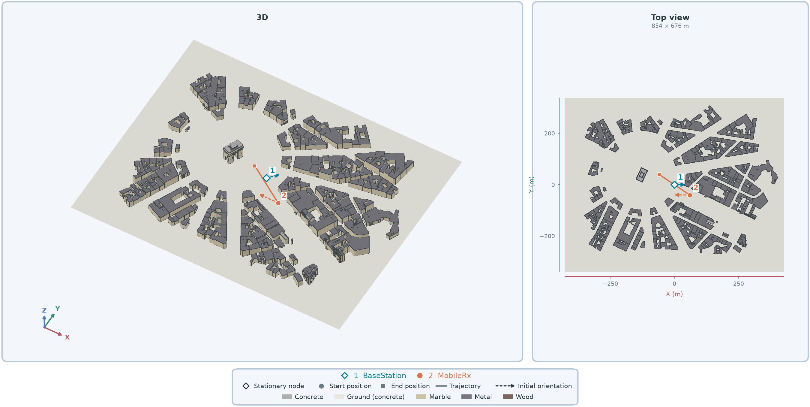

# Remote HDF5 Frame Generation

[Scenarios](../../../../README.md) > [Visualizer](../../../README.md) >
[Data Modes](../../README.md) > [Remote HDF5 Playback](../README.md) > Frame Generation

Generate the saved recording used by the
[Remote HDF5 Playback example](../README.md). It writes reusable chunks to `frames/`. It does not start
the frame-file server.

To run it, see [Running](#running).

## Scene Layout



## Generated Frame Set

| Element | Value |
| --- | --- |
| Scene | Built-in [Sionna RT](https://nvlabs.github.io/sionna/) `etoile` scene |
| `BaseStation` | Fixed transmitter at `(0.0 m, 0.0 m, 30.0 m)` |
| `MobileRx` | Linear route from `(60.0 m, -40.0 m, 1.5 m)` to `(-60.0 m, 40.0 m, 1.5 m)` |
| Timeline | 50 frames over 5 seconds |
| Output | Reusable HDF5 chunks and `frames_manifest.json` under `generation/frames/` |

Remote playback serves this ordinary
[HDF5 frame set](../../../../../docs/shared/frame_reference.md#hdf5-frame-layout) without
regenerating it.

The [scenario.yaml](scenario.yaml) omits `data` because local HDF5 generation under `frames/` is
the default file-output workflow.

## Running

Run commands from the repository root.

Generate the frames:

```bash
orchav-generator scenarios/visualizer/data_modes/remote_hdf5/generation
```

The recording is now ready in `frames/`. Follow the
[remote playback steps](../README.md#running) to start the server and connect
the Visualizer.

## Browse Scenarios

Up: [Visualizer](../../../README.md) ·
[Data Modes](../../README.md) ·
[Remote HDF5 Playback](../README.md)
