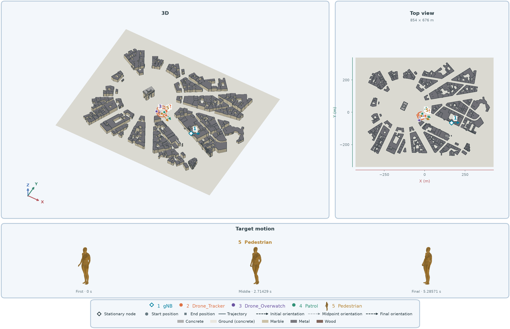
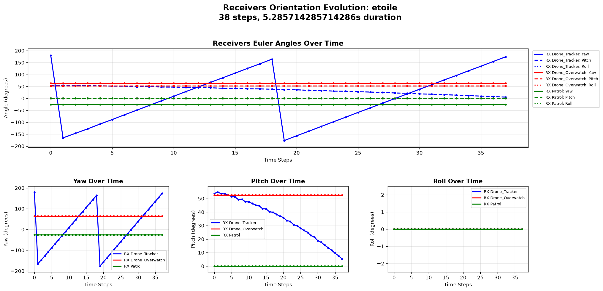

# Multi-Device Trajectory

This Visualizer scenario uses the
[Sionna RT](https://nvlabs.github.io/sionna/) `etoile` scene, which represents
the Arc de Triomphe roundabout in Paris. It places one rooftop transmitter,
two airborne receivers, one ground receiver, and one moving pedestrian mesh in
the scene so users can inspect trajectories, orientations, actor selection,
and per-link multipath views over 38 frames.

The moving pedestrian mesh is a visual reference whose geometry can also
affect propagation paths. This keeps target motion visible while users inspect
receiver trajectories and per-link MPCs.
It uses the [NIST walking target](../../../libraries/targets/digital_twin_update1/README.md)
at 7 fps, walks approximately 1.876 m in 5.286 s, and faces along the avenue.
The finite pose sequence holds its final mesh instead of looping.

To run it, see [Running](#running).

## Scene Layout



| Element | Role |
| --- | --- |
| `gNB` | Stationary rooftop transmitter near the Arc de Triomphe |
| `Drone_Tracker` | Descending airborne receiver following the pedestrian |
| `Drone_Overwatch` | Higher-altitude airborne receiver sweeping beside the route |
| `Patrol` | Ground-level receiver moving parallel to the pedestrian |
| `Pedestrian` | Moving mesh target whose geometry can affect radio paths |
| `etoile` | Sionna RT-provided Arc de Triomphe roundabout scene |

## Scenario Configuration

```yaml
timeline:
  steps: 38
  duration_s: 5.285714285714286

raytracing:
  enabled: true
  quality:
    preset: ultra-low

generator_summary:
  enabled: true
  create: [topology, speed, orientation]
  visualization:
    actor_label_mode: name
```

[`generate.py`](generate.py) calculates the spiral and sweep waypoints, then
assigns standard waypoint, linear, and look-at models to the receivers.
Scripting avoids writing the calculated positions by hand; the mobility and
orientation models are the same ones available in YAML.

The receivers use a custom wedge-shaped display marker instead of the default
sphere. This excerpt from [`scenario.yaml`](scenario.yaml) selects the included
[`receiver_marker.obj`](meshes/receiver_marker.obj) mesh:

```yaml
visualizer:
  node_markers:
    rx:
      shape: mesh
      mesh_path: meshes/receiver_marker.obj
      marker_size: 4.0
```

The same marker represents all three receivers. It changes their appearance
in the Visualizer without adding scattering geometry. The pedestrian is a
separate mesh target that can affect propagation. See
[TX and RX markers](../../../docs/visualizer/scenario_defaults.md#tx-and-rx-markers)
to customize the display.

Running `generate.py` writes reusable HDF5 chunks under `frames/`, while
`summary/` contains the standalone topology, speed, and orientation figures
requested by the YAML.

## Running

Run commands from the repository root.

Generate the scripted trajectories and frames:

```bash
python scenarios/visualizer/multi_device_trajectory/generate.py
```

Inspect frame 37 to check the device positions:

```bash
orchav-inspect scenarios/visualizer/multi_device_trajectory --frame 37
```

Then open the scenario:

```bash
orchav-visualizer --scenario scenarios/visualizer/multi_device_trajectory
```

## What To Notice

- In **Scene** > **Nodes**, enable **Trajectory** under **RX** to show the
  receivers' full routes. `Drone_Tracker` makes two descending turns around the
  pedestrian's route, from 35 m to 3 m. `Drone_Overwatch` follows a short offset
  sweep at 40 m, while `Patrol` moves parallel to the pedestrian at 1.5 m.
  Use playback to watch their positions change along these routes.
- In the same panel, enable **Trajectory** under **Targets** to show the
  `Pedestrian` motion with the receiver paths.
- Under **Trajectory Style**, switch **Color** from **Node** to **Speed**,
  **Altitude**, or **Time** to compare the airborne receivers with the ground
  patrol receiver.
- In the persistent **Context** controls, select a TX/RX pair to compare the
  `gNB`-to-receiver links without regenerating the HDF5 frame sequence.
- In the persistent **Camera** controls, set **Track** to `Drone_Tracker` and
  choose **Follow**. Then choose **POV** with **Look** set to **Forward** to
  inspect how its selected link changes along the 38-frame sequence.

## Orientation Diagnostics



Use the orientation figure to check that the tracker receiver changes yaw as it
orbits and pitch as it descends.

## Browse Scenarios

Up: [Visualizer scenarios](../README.md) | Previous: [Statistics](../statistics/README.md) | Related: [SIMULTECH 2026 Reproducibility](../../../docs/reproducibility/simultech_2026.md)
