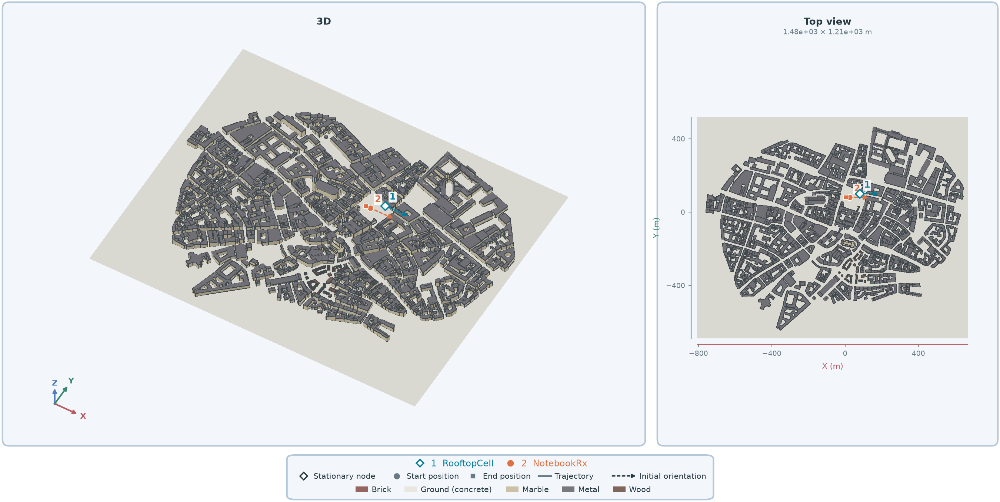
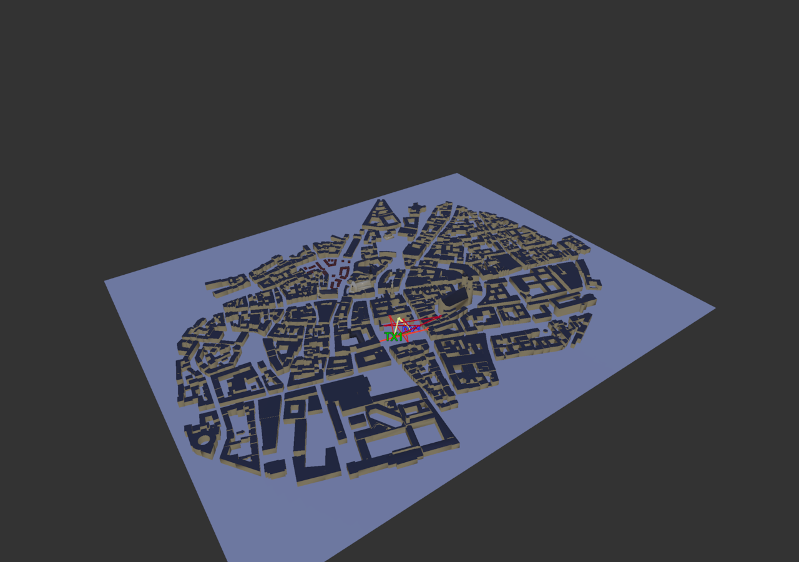

# Notebook Mode

Play a saved scenario inside Jupyter, explore an interactive 3D view, and
render still images with different appearances and path colors.

To run it, see [Running](#running).

## Scene Layout



In the built-in [Sionna RT](https://nvlabs.github.io/sionna/) Munich scene,
`RooftopCell` stays at `(80 m, 100 m, 30 m)`. `NotebookRx` moves from
`(25 m, 80 m, 1.5 m)` to `(5 m, 80 m, 1.5 m)`.

## Configuration Walkthrough

The [scenario.yaml](scenario.yaml) records this route in 100 frames over 2 s:

```yaml
timeline:
  steps: 100
  duration_s: 2.0
```

The notebook and desktop Visualizer can both read the resulting local HDF5
frame set. No separate notebook data format is needed.

## Running

Run commands from the repository root.

Install notebook support:

```bash
python -m pip install -e ".[jupyter]"
```

Generate the frames used by the notebook:

```bash
orchav-generator scenarios/visualizer/notebook_mode
```

Generation creates `frames/` for playback and a standalone layout figure under
`summary/`. Open the included
[example notebook](../../../examples/notebook/notebook_mode.ipynb):

```bash
jupyter lab examples/notebook/notebook_mode.ipynb
```

## What To Inspect

1. Select the kernel for your ORCHAV environment and run the setup cell.
   It opens this scenario with `PygfxNotebookViz`.
2. Run **Interactive Playback**. Watch `NotebookRx` move through the saved
   frames, and orbit, pan, or zoom while playback continues.
3. Run **Paper Appearance**, then **Glow Appearance And Path-Loss Coloring**.
   Compare the appearances and how path color reveals different information.
4. Run **Inspect A Still Frame** to explore a single frame with callout labels.
5. When finished, uncomment and run `viz.close()` in the final cell to release the view.



The notebook's playback rate is independent of the simulated 2 s duration.
For more rendering options and Python examples, see
[Notebook Visualization](../../../docs/visualizer/notebooks.md).

To compare the same frames in the desktop application:

```bash
orchav-visualizer --scenario scenarios/visualizer/notebook_mode --no-resume
```

## Browse Scenarios

Up: [Visualizer Scenarios](../README.md)
