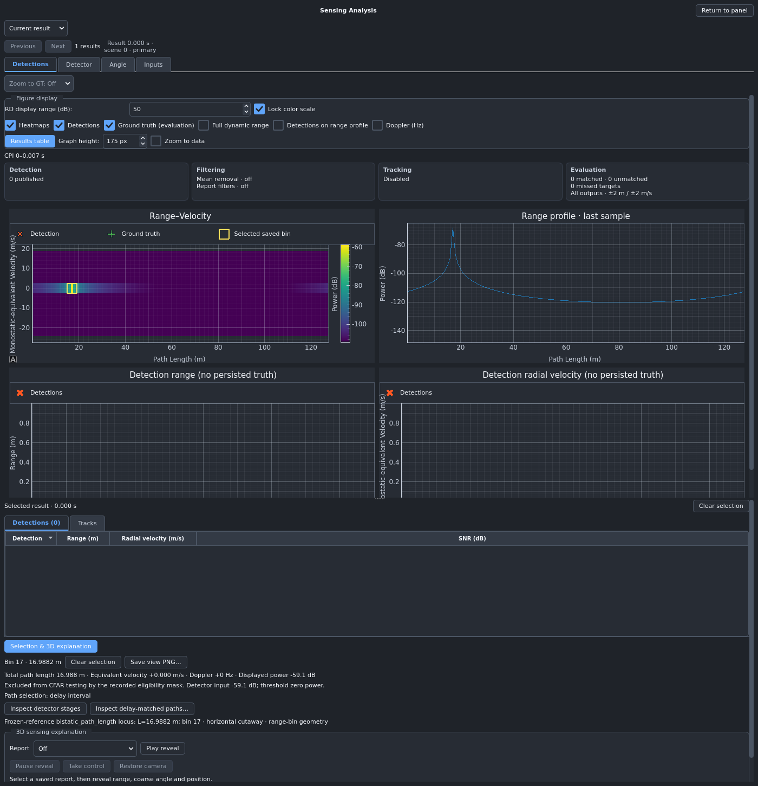
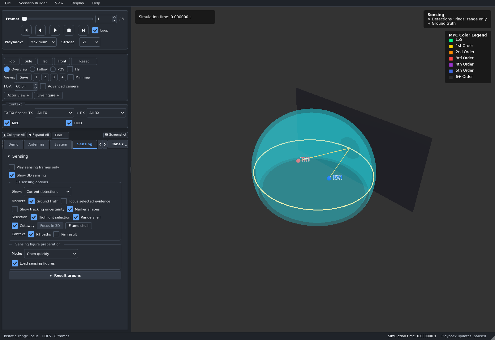
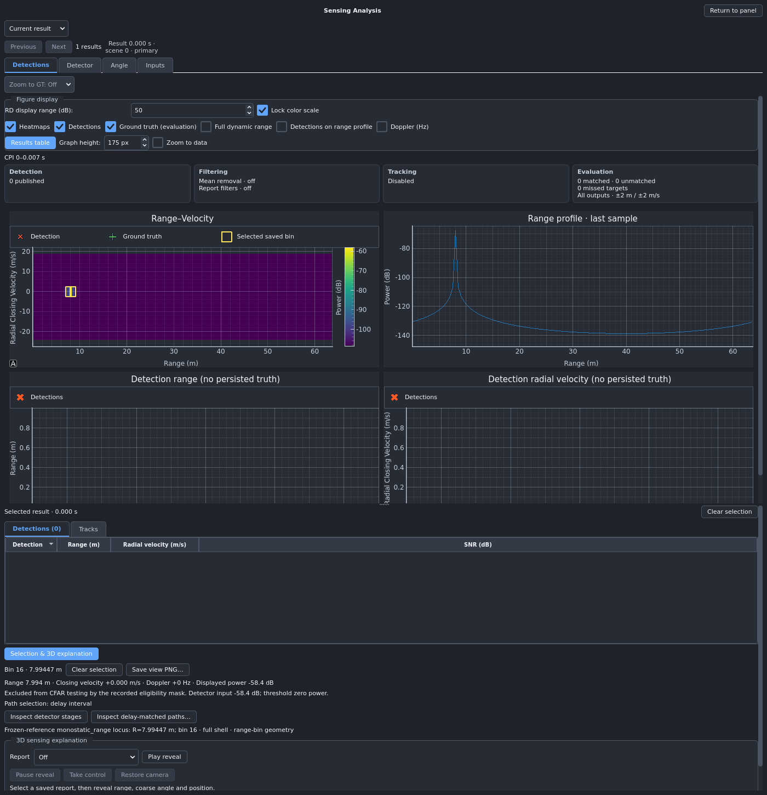
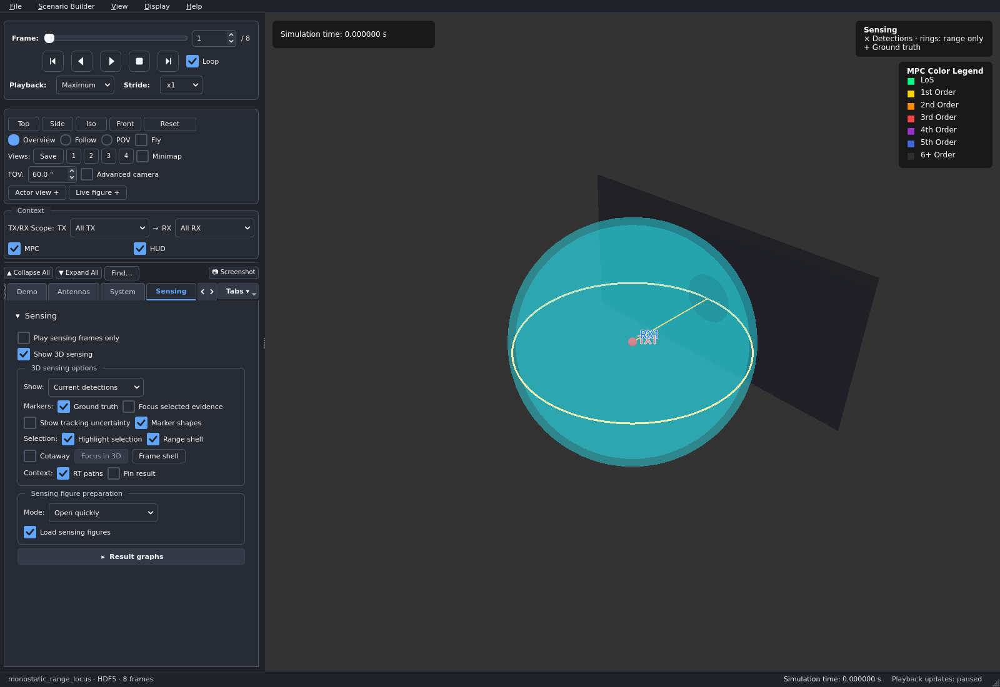
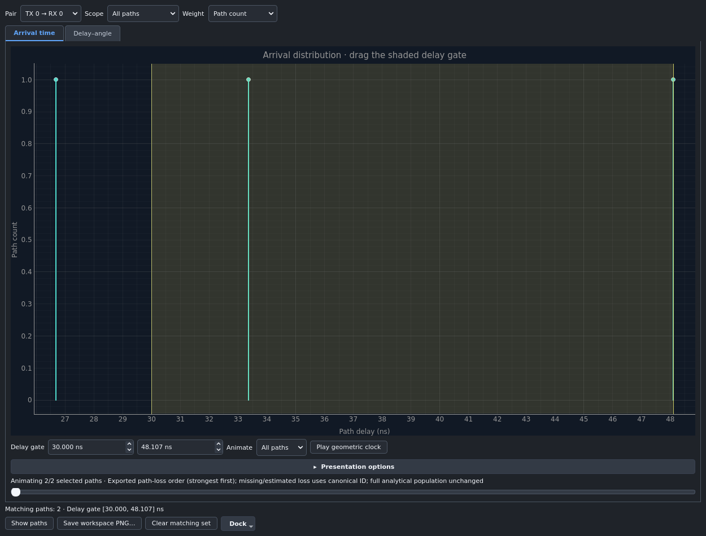
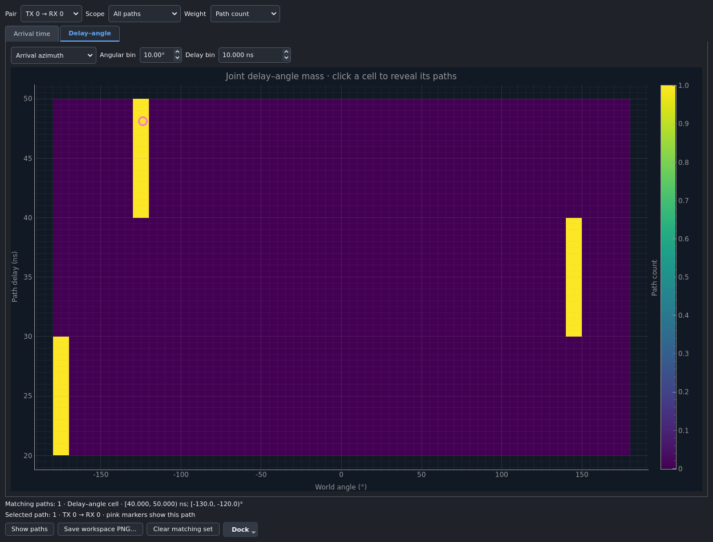

# Select A Sensing Bin In 3D

Click a saved range–Doppler cell and inspect its range support in the main pygfx
scene. The shell updates automatically. This guided exercise uses runnable
fixtures under `examples/visualizer_experiments/`, rather than a separate
scenario in this documentation folder. The fixtures contain authored reflectors
and real generated Sionna RT observations, with no external geographic or
human-motion assets.

## Generate And Open

From the installed source checkout:

```bash
orchav-generator examples/visualizer_experiments/bistatic_range_locus
```

Open the scenario in the Visualizer:

```bash
orchav-visualizer --scenario examples/visualizer_experiments/bistatic_range_locus
```

The eight-pulse recording stores its sensing result at frame 7, bound to the
geometry-reference scene at frame 0. Keep the main scene at frame 0 for the
selection exercise. These generated frames are local outputs, not bundled data.

## Click The Bistatic Return

1. Open **Sensing → Result graphs** in the main window
2. Choose **Current result → Detections** and find the bright return near path length 17 m
3. Click the range–velocity heatmap near 16.9882 m and 0 m/s. In this reference
   recording those are zero-based range bin 17 and Doppler bin 4
4. The selected cell receives a yellow outline. The selection row names the
   exact bin and coordinate
5. In the main **Sensing** panel, enable **Show 3D sensing** and **Range shell**
   to display its cyan shell. No separate transfer or apply button is needed
6. Enable **Cutaway** in the same section to reveal the section through the
   sensor midpoint, or disable it to view the complete surface
7. Use **Frame shell** to fit the selected locus in the camera when
   needed. Ordinary cell clicks leave your chosen camera in place
8. Click another valid range cell. The old shell is replaced by the new selected
   bin's support. Expand **Selection & 3D explanation** below the dashboard's
   results table and choose **Clear selection** to remove the highlight and shell



The main **Sensing** panel provides **Show 3D sensing**,
**Range shell**, **Cutaway**, and **Frame shell** as described above. The
dashboard's **Selection & 3D explanation** section shows saved values and
links to the selected cell's detector and path evidence. The shell controls
remain in the main **Sensing** panel when the dashboard is popped out.
The selected value is a recorded numeric coordinate, not an estimated target
position or a tracker identity.



## Compare The Monostatic Sphere

Generate and open the matching co-located-sensor fixture:

```bash
orchav-generator examples/visualizer_experiments/monostatic_range_locus
```

Open the scenario in the Visualizer:

```bash
orchav-visualizer --scenario examples/visualizer_experiments/monostatic_range_locus
```

Keep scene frame 0. Open **Sensing → Result graphs**, choose **Current result → Detections**, and
click near 7.99447 m and 0 m/s (zero-based range bin 16, Doppler bin 4).
The same controls now display a sphere centered on the co-located sensors.
Enable **Show 3D sensing**, then use **Frame shell** under **3D sensing options**
before saving the scene screenshot. Toggle the cutaway to compare its circular
section with the bistatic elliptical section.





The underlying wall is 8 m away, producing a 16 m round-trip reflected path.
The displayed one-way range is approximately 7.99447 m because it is a numerical
cell center. Bistatic labels instead show total path length. Opening the new
recording retires the previous recording’s selection; select a new cell rather
than carrying its sphere/ellipsoid across recordings.

## What The Shell Means

For bistatic total path length L, the surface satisfies
`distance(TX, point) + distance(point, RX) = L`. The transmitter and receiver
are its foci. For monostatic one-way range R, the corresponding locus is a
sphere of radius R around the co-located sensors. Do not use total bistatic
path length as a receiver radius.

The shell uses the recorded sensor pair and frozen geometry-reference pose.
Thickness shows retained numerical bin support, or explicitly labeled
midpoint-derived display boundaries. It is a direct-two-leg geometric locus,
not target localization, uncertainty, visibility, antenna illumination or an
extra ray-tracing result. A reflected path can have the selected total length
without identifying a physical target anywhere on that shell. Impossible or
degenerate geometry is rejected rather than silently repaired.

The velocity axis for the bistatic example is monostatic-equivalent velocity,
not the full path-closing rate. Range geometry does not use Doppler to infer a
unique point. For a moving target and explicit paired truth, continue with the
[range and velocity conventions](../../../docs/sensing/concepts.md).

## Save And Check The View

**Save view PNG…** in **Selection & 3D explanation** exports the dashboard's
plots, selection and context.
The main viewer's **Screenshot** command saves the 3D scene. Save both when
reporting an interpretation: a dashboard plot alone does not show the 3D shell.

Keep selection bound to the current recording, result, sensor pair and scene
reference. Navigating away from that scene or closing the owning dashboard
clears transient geometry; a stale or incompatible selection must not silently
carry into a different acquisition. Reopen the dashboard and select a fresh cell
when switching recordings.

These captures use the native Qt application with pygfx 0.17, Mesa software
Vulkan and **Display → Theme → Dark**. The existing recordings were loaded
without rerunning acquisition or processing. The
[capture receipt](figures/capture-receipt.json) binds the six PNGs to their input
and recording hashes, acquisition identities, selected coordinates and rendering
runtime. This checks the documented interaction, not physical RF accuracy or
performance across GPUs and platforms.

## Related Interpretation Tools

Use the companion courtyard recording to explore two other saved-path gestures:

```bash
orchav-generator examples/visualizer_experiments/arrival_courtyard
```

Open the scenario in the Visualizer:

```bash
orchav-visualizer --scenario examples/visualizer_experiments/arrival_courtyard
```

Open **Paths → Appearance → Path tools → Path Analysis…**. Keep pair
**TX 0 → RX 0**, scope **All paths**, and weight **Path count**.

### Gate Arrival Times

In **Arrival time**, set the lower **Delay gate** field to 30 ns. Two of the
three recorded paths remain, giving 66.7% of the pair/scope count. The scene
highlights those complete paths. The shaded gate can also be dragged.
**Play geometric clock** moves a pulse using route arc length divided by the
speed of light; this is geometric playback, not a measured bounce-time record.



### Select A Joint Delay–Angle Cell

Switch to **Delay–angle**, choose **Arrival azimuth**, and set **Angular bin**
to 10° and **Delay bin** to 10 ns. Click the cell with delay [40, 50) ns and
angle [-130, -120)°. In this recording the selected cell contains exactly
**Path 1**, with one contributing path. Choose **Show paths** to open the
matching rows in Path Explorer, then select that row to inspect its details.
Path IDs are local to the saved frame and may differ in a new recording.



These numerical bins describe the displayed saved observations; they are not
physical clusters. These views highlight saved MPC identities without
recomputing acquisition. See the [pygfx interpretation guide](../../../docs/visualizer/path_inspection.md)
for weights, missing data, scope and lifecycle semantics.

## Browse Scenarios

Up: [Visualizer scenarios](../README.md) | Related: [Sensing dashboard tour](../../../docs/visualizer/sensing_dashboard.md) ·
[Procedural interpretation examples](../../../examples/visualizer_experiments/README.md)
