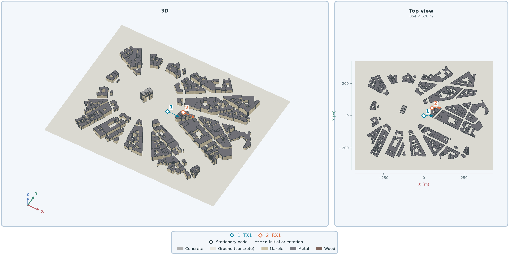

# Synthetic MPC Benchmark

Generate random propagation paths to explore Visualizer performance as the
number of MPCs increases. This example writes ordinary HDF5 frames without
running [Sionna RT](https://nvlabs.github.io/sionna/). Its random paths are for
software benchmarking, not physical channel analysis.

To run it, see [Running](#running).

## Scene Layout



## Running

From the repository root, generate the default workload of 10 frames with
10,000 MPCs per frame:

```bash
python scenarios/visualizer/synthetic_mpc_benchmark/generate.py
```

The script creates a scratch scenario at `tmp/orchav_bench_10k`, with its own
`scenario.yaml` and HDF5 data under `frames/`. Open that directory:

```bash
orchav-visualizer --scenario tmp/orchav_bench_10k --renderer pygfx --no-resume
```

## What To Inspect

1. Play the frames and open **System → Performance**. Watch **Update work**,
   **Work average**, and **Renderer submit**.
2. Under **Paths → Filtering → Top K**, enable **Keep strongest paths** and
   change **K**. Compare playback with fewer displayed paths.
3. Replay the sequence. Use **Cache** and **Preload Status** under
   **Performance** to distinguish initial loading from cached playback.

## Change The Workload

Use `--frames` and `--mpcs` to choose the recording length and paths per frame.
Generate a small synthetic workload:

```bash
python scenarios/visualizer/synthetic_mpc_benchmark/generate.py --frames 2 --mpcs 10 --output tmp/orchav_bench_smoke
```

Open the generated workload:

```bash
orchav-visualizer --scenario tmp/orchav_bench_smoke --no-resume
```

Larger workloads need more memory. See the
[synthetic-frame options](../../../docs/shared/synthetic_frames.md#configuration)
for varying path counts, interaction limits, and random seeds.

## Renderer Benchmarking

Record timings for the default workload:

```bash
orchav-visualizer --renderer pygfx --scenario tmp/orchav_bench_10k --benchmark 30 --benchmark-warmup 5 --benchmark-output tmp/orchav_visualizer_bench/pygfx.json --no-resume
```

The command writes timing results to the specified JSON file. See the
[timing options](../../../docs/shared/synthetic_frames.md#benchmarking) and
[cache tuning guide](../../../docs/visualizer/caching.md#tuning-large-scenarios)
before comparing runs.

## Current Trend Measurement

Compare matched runs on the same hardware, viewport, display, and cache
settings, and repeat them to see timing variation. Results describe that
software and hardware setup. Keep generated workloads and timing files under
`tmp/` or another scratch directory.

## Browse Scenarios

Up: [Visualizer Scenarios](../README.md)
